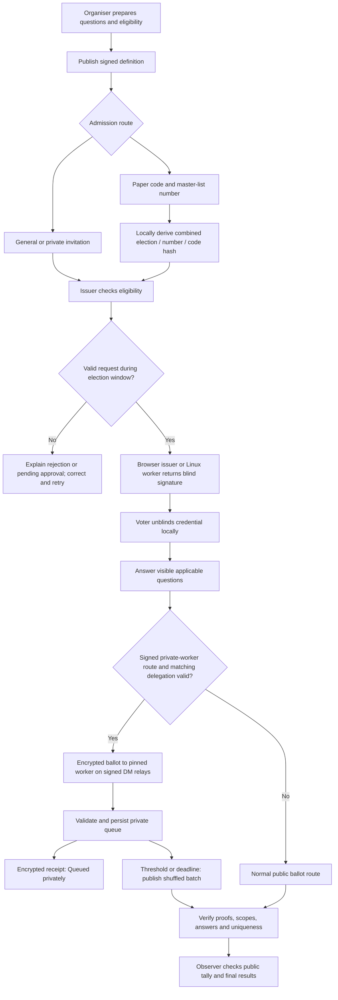

# Voting workflow and tutorials

This is the canonical guide to the shipped questionnaire flow. Read it before
the [demo walkthrough](demo-guide.md). The [browser edition](../web/public/voting-workflow.html)
provides the same overview and tutorials without a Mermaid renderer.

**Start demo opens an isolated offline sandbox at `/demo.html`.** Its fictional
roles and records never enter the live app. Reset or reload repeats the same
election. It runs offline after its assets load; cold offline access needs a
locally served build. It does not verify real cryptography or transport.
The tutorials below describe the **real app**, not the simulated sandbox;
ordinary publish/submit controls create real records. Use test identities and
fictional answers for a live rehearsal.

## 1. Overview



The public route is the current fallback when private routing is absent,
invalid or mismatched. **Do not assume timing privacy just because a worker is
configured.** Check the signed definition and the matching delegation before
opening a real election. The route needs both private-queue and batch-release
capabilities.

## 2. Milestones: what each status means

| Milestone | Meaning | Does not mean |
| --- | --- | --- |
| Admission request sent | The voter has asked for access | Eligibility has been accepted |
| Ballot received | All required blind credentials arrived | Answers have been submitted |
| Queued privately | The pinned worker acknowledged durable private intake | The ballot is publicly released or in the final tally |
| Public release | A public response is available for verification | Every response is valid or the election is final |
| Verified acceptance | Proof, scope, answer and uniqueness checks passed | The organiser has published final results |
| Final results | The published final result can be independently checked | The observer should trust the organiser without checking |

## 3. Who can see what?

| Actor | Information available |
| --- | --- |
| Organiser / credential issuer | Eligibility and admission requests; paper admission hash; identity-bound issuance/recovery records. No paper code or number is needed in the anonymous ballot. |
| Private ballot worker | Private ballot arrival metadata and ballot payloads it handles. It reports aggregate progress, not voter-linked ballot decisions, to the organiser. |
| Relays | Public records; encrypted DM envelopes and network/timing metadata for traffic they carry. |
| Observer | Released public responses, proofs and results. Encrypted answer text needs the appropriate decryption key. |
| Voter | Their identity, admission inputs, credentials, answers and receipt/recovery state. |

Blind issuance separates eligibility from the anonymous response. It does not
remove timing correlation, device compromise or coercion. If one operator runs
both issuer and ballot worker, that operator has both roles' visibility.

## 4. Organiser tutorial

1. Open Organiser. Choose test identities for a rehearsal; retain encrypted
   backups for real operation.
2. Create the questionnaire. Set its opening/closing times, voter groups,
   required questions and conditional follow-ups. English remains the base
   text; French and Tamil translations are optional. Paper output is English.
3. Choose the issuer: keep the organiser browser online, or configure the
   delegated Linux worker. Ensure its private configuration is delivered.
4. Choose admission: general access with eligibility approval, private invites,
   or paper/email credential codes. For timing mitigation, set the signed private-worker identity,
   DM relay allowlist, threshold and deadline, with queue/release delegation,
   before publishing. Do not add these to an already immutable definition.
5. Publish the definition and open/select that questionnaire in Organiser so its
   issuer runtime is available. Under **Session → Results & Voters** (Voters),
   find **Paper ballot access**. For paper, enter master-list numbers and a future
   expiry; generate and print the ten-character Crockford codes. Printouts are
   sensitive bearer material. Stored admission records retain the combined
   election/number/code hash plus lifecycle metadata, not the plain values or
   a separate roster hash.
6. For resident email, start the loopback coordinator companion with
   `npm --prefix web run email:sender` and open its local URL. In **Resident
   email admission**, one **Import** action loads an editable resident CSV;
   **Add row**, **Remove**, **Set defaults** and one context-sensitive
   **Export** complete the table. Set a future expiry, generate the same
   paper-compatible codes, and use **Send emails** to deliver one message per
   resident through SMTP or cashu.email. Credentials stay in the companion
   process. Codes are masked until deliberately revealed. Export and the CLI
   remain fallbacks. Email does not share the voter's code with Nostr, but it is
   visible to the mail provider. See [the email runbook](otp-delivery.md).
7. Do not generate another paper or email batch for the same roster after
   reload: with hash-only storage the app cannot find and revoke the earlier
   codes. Both may remain usable. Duplicate checks cover the open batch only.
8. Test private receipts, email links and batch release in a separate rehearsal
   election before using that configuration for real voters. A delivered message
   is not proof of ballot receipt. Share the appropriate invite only once the
   issuer is ready. Watch credential delivery separately from aggregate private
   queue progress. A pending access request may need eligibility approval; a
   valid paper/email credential request issues without another manual approval.
9. Allow the configured final batch release to finish, then close and publish
   results using the normal organiser controls. Paper/email-admission rounds do
   not use automatic expected-count completion; the organiser controls closure.
10. Ask an Observer to verify the result independently.

## 5. Voter tutorial

1. Open the questionnaire invite. With a printed or emailed admission code,
   enter its code and your master-list number in the admission fields on Vote.
   These inputs derive the admission hash locally; they are not part of the
   anonymous ballot.
2. Send the access request. Correct a mistyped admission entry while access is
   pending. Wait for the blind credential; sending the request is not admission.
   A valid code is bound to the admitted identity and cannot admit another
   identity. Keep this browser state or its encrypted backup for recovery.
3. Select English, French or Tamil as available. Answer only applicable
   questions. Hidden follow-ups are excluded; required visible questions must
   be completed. Printed instructions state when to answer or leave blank.
4. Submit. For private batching, wait for the pinned worker's encrypted
   **Queued privately** receipt. If rejected, read the reason; do not treat a
   sent DM as an accepted ballot.
5. Keep the submission details for audit. A queued ballot may not appear in
   Observer until a threshold or deadline release. Do not submit a new identity
   merely because publication is delayed.
6. After release, check the public response and final result in Observer.
   **Ballot details** in Settings helps diagnose request or receipt problems.

## 6. Observer tutorial

1. Open Observer and locate the signed questionnaire by ID or organiser.
2. Check the definition, eligibility/issuer authority, and any private release
   policy. A quiet public stream before batch release is not proof of failure.
3. After release, inspect Submitted Votes: proof validation, scopes,
   conditional answers, duplicate/nullifier handling and rejection reasons.
   A paper code and master-list number must not appear in the response payload.
4. Aggregate batch records show batch ID, reason and count, not a voter-to-ballot
   mapping. **Observer does not display these records yet.** Inspecting them
   requires an external Nostr relay/event inspection tool and the worker's
   public records; this is a technical audit task, not a control in Observer.
5. Recompute the tally and compare it with the final result. Report missing or
   inconsistent evidence; a receipt alone is not public proof of inclusion.

## 7. Admission and issuance sequence

```mermaid
sequenceDiagram
    participant O as Organiser
    participant V as Voter browser
    participant I as Configured issuer (browser or worker)
    O->>I: Private admission configuration (combined hashes only)
    O->>V: Paper printout: code, number, expiry and instructions
    V->>V: Derive combined admission hash; blind fresh credential request
    V->>I: Encrypted request with admission hash and request identity
    I->>I: Check election window, scope, expiry and admission state
    alt Invalid or bound to another voter
        I-->>V: Refuse issuance
    else Valid admission
        I->>I: Persist redemption binding and recoverable issuance state
        I-->>V: Encrypted blind signature / credential bundle
        V->>V: Unblind and retain credentials locally
    end
    Note over V,I: Exact retries replay retained issuance; they must not mint extra credentials
```

## 8. Private batching sequence

```mermaid
sequenceDiagram
    participant V as Voter browser
    participant W as Pinned ballot worker
    participant O as Organiser
    participant R as Public relays / Observer
    V->>W: NIP-17 encrypted ballot on signed DM relays
    W->>W: Validate proof, scope, answers, nullifier and deadline
    W->>W: Persist accepted queue entry
    W-->>V: Encrypted accepted receipt
    W-->>O: Encrypted aggregate progress
    Note over W,R: No public ballot before threshold or deadline
    W->>W: Fix batch membership; shuffle; persist exact signed events
    W->>R: Fresh public ballot events with common release time
    W->>R: Aggregate batch record
    W-->>O: Updated aggregate progress
    R->>R: Independently verify and tally
```

## 9. Retry and recovery

```mermaid
sequenceDiagram
    participant V as Voter browser
    participant I as Issuer / worker
    participant D as Durable local state
    participant R as Relay
    V->>I: Retry same request after lost response
    I->>D: Look up bound request and retained issuance / queue entry
    D-->>I: Existing result
    I-->>V: Replay encrypted result, not a second credential
    Note over V,I: Restored voter state resumes receipt listening with the response key
    I->>D: Load prepared signed public event after restart
    I->>R: Retry identical event with the same event ID
    R-->>I: Publication result
    I->>D: Persist completion; retry failed entries only
```

Retries reuse identifiers; they do not guarantee a network packet is sent only
once. Identical prepared public events retain their IDs for relay deduplication.
Loss of issuer state, keys or voter recovery secrets is a different failure:
stop and follow the election's recovery procedure rather than issuing an extra
vote. A valid paper admission retry remains bound to the original voter.

## 10. Remaining admission limitations

- Signed reusable admission grants scoped to eligibility group, issuer, voter
  and expiry remain future work. Every election still needs fresh credentials.
- Emailed codes use the shipped paper admission protocol, not a browser-local
  OTP flag. Actual mail delivery still depends on the coordinator's sender,
  provider and recipient; test small controlled sends and retain paper/manual
  fallback. Codes and contact details are sensitive exports, not relay inputs.
- SMS provider integration is not implemented. Worker/Nostr connectivity is a
  separate concern from SMS or email delivery.

For the broader protocol variants, see the
[technical note](technical-protocol-note.md) and
[questionnaire protocol reference](questionnaire-blind-token-protocol.md).
